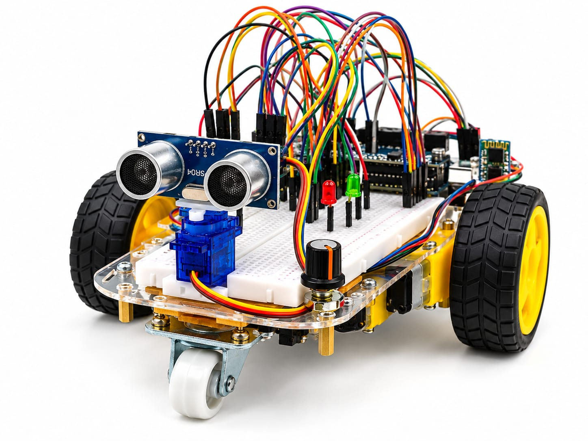
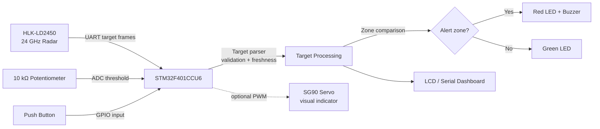

# STM32 Radar Target Detection & Threat Alert System

  <strong>Real-time target tracking. Configurable alert zones. Embedded-first design.</strong>

  

  
  
  
  

## Overview

This project is a compact STM32-based indoor radar demonstrator. The controller receives target telemetry from the **HLK-LD2450** over UART, evaluates a configurable software-defined alert zone, and drives local warning outputs.

The system is designed for embedded-systems learning: UART communication, packet parsing, ADC input, GPIO control, PWM, fault handling, and real-time status reporting.

> **Scope:** This is an educational human-motion tracking prototype. It is not an aircraft, vehicle, missile, or object-classification system.

## Architecture

### Data flow

1. The radar reports moving-target data through UART.
2. The STM32 validates frames and updates target records.
3. Target distance/position is compared with the adjustable alert threshold.
4. LEDs, buzzer, and display communicate the current state.
5. Missing or stale data produces a sensor-fault state instead of a false “clear” state.

## Hardware

| Component | Role |
|---|---|
| STM32F401CCU6 Black Pill | Main controller |
| HLK-LD2450 | Moving-target radar sensor |
| 10 kΩ potentiometer | Alert-zone threshold input |
| Red/green LEDs | Status indication |
| Active buzzer | Local threat-zone alert |
| Push button | Acknowledge or pause/resume control |
| 16×2 I²C LCD / laptop | Optional telemetry display |
| SG90 servo | Optional visual feature only |

### Candidate pin map

| Signal | Candidate pin | Notes |
|---|---|---|
| LD2450 TX | PA10 / USART1_RX | Cross-connect TX to RX |
| LD2450 RX | PA9 / USART1_TX | Verify logic levels |
| Potentiometer wiper | PA0 / ADC1_IN0 | Use 0–3.3 V only |
| Servo PWM | PA8 / TIM1_CH1 | Use a separate regulated 5 V supply |
| LCD I²C | PB8/PB9 | Verify pull-up voltage |

> Confirm the exact radar-board variant, supply voltage, UART settings, pin alternate functions, and logic levels before wiring.

## Firmware status

The current `code.c` is an **HC-SR04 ultrasonic baseline**. It demonstrates ADC, PWM, GPIO, UART text output, and servo control. It does not yet implement the LD2450 UART receiver or radar packet parser.

### Planned firmware modules

- UART receiver and frame parser
- Target validation and freshness timeout
- Coordinate, distance, and speed processing
- Configurable alert-zone manager
- LED, buzzer, button, and display drivers
- Test harness for valid, malformed, and stale frames

## Key contributions

- Sensor-adapter design for a common target representation
- Adjustable software-defined detection zone
- Multi-output alerts through LEDs, buzzer, and display
- Explicit handling of malformed, missing, and stale sensor data
- Documented wiring, power, test, and demonstration procedure

## Demonstration

1. Keep the radar stationary on a stable surface.
2. Power the STM32 and verified radar supply separately where required.
3. Open the serial/dashboard view and confirm healthy communication.
4. Adjust the threshold with the potentiometer.
5. Move through the marked zone and observe telemetry and alerts.
6. Leave the zone and verify that the alert clears.
7. Demonstrate the stale-data/fault state if the radar stream is interrupted.

## Safety and limitations

- Use the exact HLK-LD2450 documentation for power and UART requirements.
- Never apply an unverified 5 V signal to an STM32 input.
- Use resistors for bare LEDs and a transistor driver when buzzer current requires it.
- Power the SG90 from a regulated external 5 V supply; share signal ground with the STM32.
- The radar is intended for moving human targets and may not reliably detect stationary objects.
- Do not claim target identity or military-grade radar performance.

## Contributors

- **Ganesh Giridhar** — Project coordination, system architecture, STM32 firmware integration, radar-interface planning, documentation, and final testing.
- **Suhas Reddy** — Hardware research, component verification, and wiring support.
- **GR Balaji** — Test-plan preparation, alert-zone validation, and demonstration support.
- **J Maneesh** — Presentation support, results recording, and project documentation assistance.

## License

This project is intended for academic and educational use.
