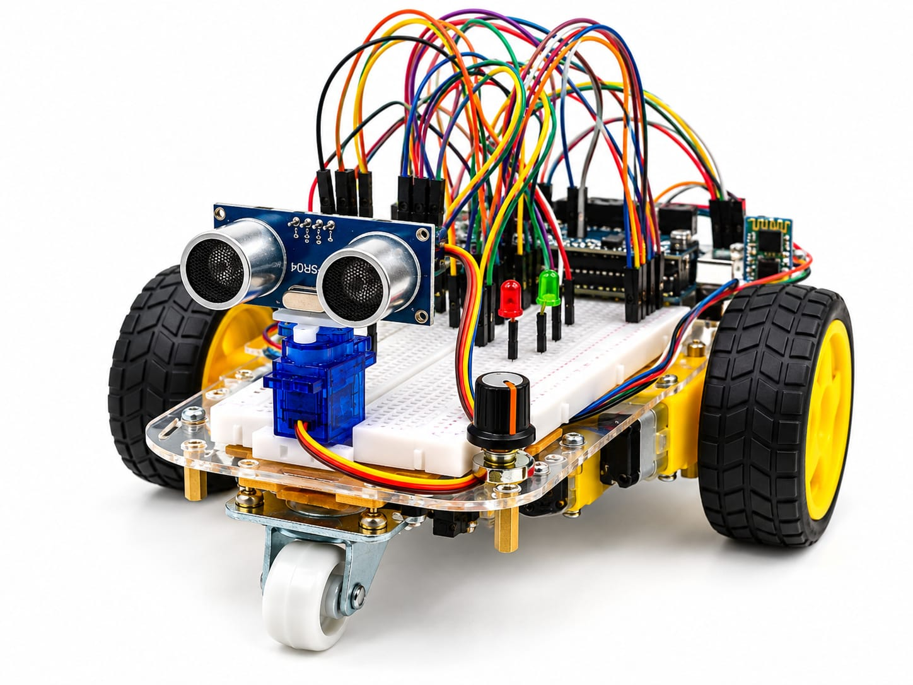
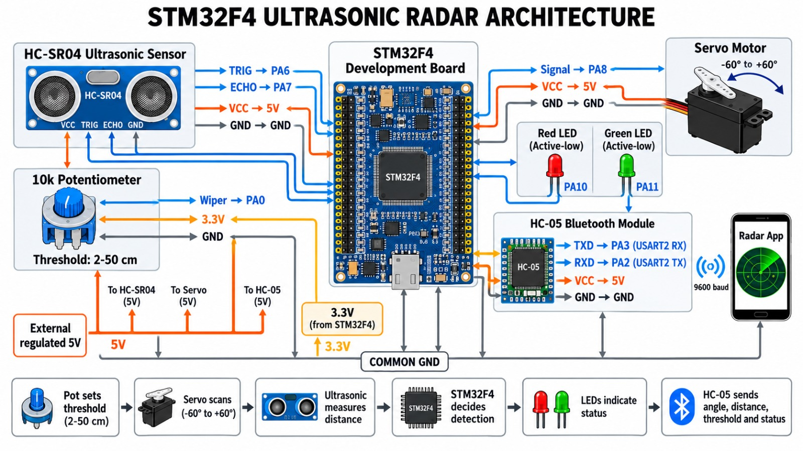

# STM32 Radar Target Detection & Threat Alert System

<p align="center">
  
</p>

<p align="center">
  
  
  
  
  
</p>

---

## Table of Contents

- [Project Summary](#project-summary)
- [Demo Video](#demo-video)
- [System Architecture](#system-architecture)
- [Hardware Components](#hardware-components)
- [Pin Mapping](#pin-mapping)
- [Firmware Overview](#firmware-overview)
- [How to Build & Run](#how-to-build--run)
- [Repository Structure](#repository-structure)
- [Future Enhancements](#future-enhancements)
- [Academic Details & Acknowledgements](#academic-details--acknowledgements)
- [License](#license)

---

## Project Summary

This project implements a **real-time target detection and threat alert system** built on the **STM32F401CCU6 (Black Pill)** microcontroller. The system uses an **HC-SR04 ultrasonic sensor** mounted on a **SG90 servo motor** that continuously sweeps across a 120° field of view (−60° to +60°). When an object is detected within a **user-adjustable threshold distance** (controlled via a potentiometer connected to the ADC), the system triggers multi-modal alerts:

- 🔴 **Red LED** — lights up to indicate a target detected within the alert zone.
- 🟢 **Green LED** — lights up when the zone is clear.
- 📊 **Serial Telemetry** — real-time angle, distance, threshold, and status data streamed over UART at 9600 baud.
- 🔄 **Servo Sweep** — continuous directional scanning to cover the detection area.

The entire firmware is written in **bare-metal C** using direct **CMSIS register-level** programming — no HAL or RTOS — providing deep hands-on experience with STM32 peripheral configuration including **USART, ADC, TIM/PWM, and GPIO**.

An accompanying **Android application** ([`app/Ultrasonic_Radar.apk`](app/Ultrasonic_Radar.apk)) provides a radar-style visual display of the live sensor data received over a serial/Bluetooth connection.

---

## Demo Video

<p align="center">
  <a href="https://youtu.be/lrETVZGZDfk">
    
  </a>
</p>

> 🎬 **[Click here to watch the full working demonstration →](https://youtu.be/lrETVZGZDfk)**
>
> The video shows the servo sweeping, real-time distance measurement, LED alert switching, and serial telemetry output.

---

## System Architecture

<p align="center">
  
</p>

### Data Flow

```
┌─────────────┐    Trigger/Echo     ┌──────────────────┐
│  HC-SR04    │ ◄──────────────────► │  STM32F401CCU6   │
│  Ultrasonic │    (PA6 / PA7)       │  (Black Pill)    │
└─────────────┘                      │                  │
                                     │  ┌────────────┐  │
┌─────────────┐    ADC (PA0)         │  │ Main Loop  │  │
│ 10kΩ Pot    │ ────────────────────►│  │            │  │
│ (Threshold) │                      │  │ 1. Read ADC│  │
└─────────────┘                      │  │ 2. Set Servo│ │
                                     │  │ 3. Measure │  │
┌─────────────┐    PWM (PA8)         │  │ 4. Compare │  │
│ SG90 Servo  │ ◄───────────────────│  │ 5. Alert   │  │
│ (Sweep)     │                      │  │ 6. Transmit│  │
└─────────────┘                      │  └────────────┘  │
                                     │                  │
┌─────────────┐    GPIO (PA10/PA11)  │                  │
│ Red / Green │ ◄───────────────────│                  │
│ LEDs        │                      │                  │
└─────────────┘                      │                  │
                                     │                  │
┌─────────────┐    UART TX (PA2)     │                  │
│ Serial      │ ◄───────────────────│                  │
│ Monitor/App │                      │                  │
└─────────────┘                      └──────────────────┘
```

### Processing Pipeline

1. **Read ADC** — Sample potentiometer voltage on PA0 → map to threshold range (2–50 cm).
2. **Set Servo Angle** — Update PWM duty cycle on PA8 → servo rotates to the current scan angle.
3. **Measure Distance** — Send 10µs trigger pulse on PA6 → measure echo pulse width on PA7 → compute distance (pulse_µs ÷ 58 = cm).
4. **Compare** — If `0 < distance ≤ threshold` → target detected (THREAT); else → CLEAR.
5. **Alert** — Red LED ON + Green LED OFF on detection; inverted on clear (active-low).
6. **Transmit** — Send `Angle | Distance | Threshold | Status` over UART at 9600 baud.
7. **Sweep** — Increment/decrement angle by 5° each cycle; reverse direction at ±60°.

---

## Hardware Components

| # | Component | Specification | Role |
|---|-----------|--------------|------|
| 1 | **STM32F401CCU6 Black Pill** | ARM Cortex-M4, 84 MHz, 256 KB Flash | Main microcontroller |
| 2 | **HC-SR04** | Ultrasonic, 2–400 cm range | Distance measurement sensor |
| 3 | **SG90 Micro Servo** | 180° rotation, PWM controlled | Directional sweep (−60° to +60°) |
| 4 | **10 kΩ Potentiometer** | Linear taper | User-adjustable alert threshold via ADC |
| 5 | **Red LED + 220Ω Resistor** | 5 mm, active-low | Threat/target-detected indicator |
| 6 | **Green LED + 220Ω Resistor** | 5 mm, active-low | Clear/safe-zone indicator |
| 7 | **Breadboard + Jumper Wires** | 830-point, M-M / M-F | Prototyping interconnections |
| 8 | **USB Cable** | Micro-USB | Power + programming interface |
| 9 | **ST-Link V2** | SWD debugger | Firmware flashing and debugging |

---

## Pin Mapping

| Signal | STM32 Pin | Peripheral | Notes |
|--------|-----------|-----------|-------|
| HC-SR04 Trigger | PA6 | GPIO Output | 10µs pulse to start measurement |
| HC-SR04 Echo | PA7 | GPIO Input | Pulse width proportional to distance |
| Potentiometer Wiper | PA0 | ADC1 Channel 0 | 0–3.3V → maps to 2–50 cm threshold |
| Servo PWM Signal | PA8 | TIM1 CH1 | 50 Hz, 1–2 ms pulse (−60° to +60°) |
| Red LED (Active-Low) | PA10 | GPIO Output | LOW = LED ON (target detected) |
| Green LED (Active-Low) | PA11 | GPIO Output | LOW = LED ON (zone clear) |
| UART TX (Telemetry) | PA2 | USART2 TX | 9600 baud serial output |
| UART RX | PA3 | USART2 RX | Available for bidirectional control |

---

## Firmware Overview

The firmware ([`src/main.c`](src/main.c)) is written in **bare-metal C** using only the CMSIS `stm32f4xx.h` header — no HAL libraries, no RTOS. Every peripheral is configured via direct register manipulation.

### Module Summary

| Module | Function | Key Registers |
|--------|----------|--------------|
| **`USART2_Init`** | UART at 9600 baud on PA2/PA3 | `USART2->BRR`, `CR1`, `GPIOA->AFR` |
| **`ADC1_Init / ADC1_Read`** | Single-channel ADC on PA0 | `ADC1->CR2`, `SQR3`, `SMPR2` |
| **`Servo_Init / Servo_SetAngle`** | 50 Hz PWM on PA8 via TIM1 | `TIM1->PSC`, `ARR`, `CCR1`, `BDTR` |
| **`Ultrasonic_Init / Read_Distance`** | Trigger + echo measurement | `GPIOA->BSRR`, `IDR`, SysTick delay |
| **`LED_Init / Update_LEDs`** | Active-low red/green control | `GPIOA->BSRR`, `MODER` |
| **`main`** | Infinite loop: ADC → Servo → Sense → Alert → UART → Sweep | All of the above |

### Key Design Decisions

- **Active-low LEDs** — Pins are set HIGH to turn LEDs OFF during initialisation, preventing false alerts at startup.
- **SysTick-based microsecond delay** — Provides precise timing for trigger pulses and echo measurement without consuming a hardware timer.
- **Potentiometer-driven threshold** — 12-bit ADC value (0–4095) maps linearly to 2–50 cm, allowing real-time adjustment without re-flashing.
- **Continuous sweep** — Angle increments by 5° per cycle with direction reversal at ±60°, covering 120° of surveillance.

---

## How to Build & Run

### Prerequisites

- **STM32CubeIDE** or **Keil µVision** with the STM32F4 device pack
- **ST-Link V2** debugger (or compatible SWD programmer)
- **Serial terminal** — PuTTY, Tera Term, or Arduino Serial Monitor
- Hardware components as listed in the [Hardware Components](#hardware-components) section

### Step 1 — Wire the Circuit

1. Place the **STM32F401CCU6 Black Pill** on a breadboard.
2. Connect the **HC-SR04**: `VCC → 5V`, `GND → GND`, `TRIG → PA6`, `ECHO → PA7`.
3. Connect the **SG90 servo**: `Signal → PA8`, `VCC → external 5V supply`, `GND → common ground`.
4. Connect the **10 kΩ potentiometer**: outer pins → `3.3V` and `GND`, wiper → `PA0`.
5. Connect the **Red LED** + 220Ω resistor → `PA10` and **Green LED** + 220Ω resistor → `PA11` (active-low: cathode to pin, anode to 3.3V via resistor).

> ⚠️ **Important:** Power the SG90 servo from a separate 5V regulated supply, not from the STM32's 3.3V rail. Share signal ground between the servo supply and the STM32.

### Step 2 — Compile the Firmware

1. Create a new project in STM32CubeIDE targeting **STM32F401CCU6**.
2. Copy [`src/main.c`](src/main.c) into the project's source directory.
3. Ensure the `stm32f4xx.h` CMSIS header is included in the build path.
4. Build the project (`Ctrl+B` in STM32CubeIDE / `F7` in Keil).

### Step 3 — Flash & Run

1. Connect the **ST-Link V2** to the Black Pill's SWD header (`SWDIO`, `SWCLK`, `GND`, `3.3V`).
2. Flash the compiled binary using the IDE's built-in programmer.
3. Open a serial terminal on the corresponding COM port at **9600 baud**.

### Step 4 — Operate

1. On power-up, the **green LED** turns ON (clear state).
2. The serial terminal begins printing: `Angle: X deg, Distance: Y cm, Threshold: Z cm, Status: CLEAR / NO ECHO`.
3. Place an object within the sensor's detection range.
4. When measured distance ≤ threshold: **red LED ON**, green LED OFF, status shows `OBJECT DETECTED`.
5. Rotate the **potentiometer** to adjust the threshold distance in real time.
6. Observe the servo sweeping continuously between −60° and +60°.

### Optional — Android App

Install [`app/Ultrasonic_Radar.apk`](app/Ultrasonic_Radar.apk) on an Android device to view a radar-style graphical display of the live sensor data.

---

## Repository Structure

```
.
├── README.md                         # This file
├── src/
│   └── main.c                        # STM32 firmware (bare-metal C)
├── images/
│   ├── project-banner.jpeg           # Project banner image
│   └── architecture-diagram.jpeg     # System architecture diagram
├── docs/
│   ├── Final_Report.docx             # Case study final report
│   ├── Team1_Presentation.pdf        # Project presentation slides
│   └── demo-video.mp4                # Working demonstration video
├── app/
│   └── Ultrasonic_Radar.apk          # Android radar display application
└── project-banner.jpeg               # Banner (root, for GitHub rendering)
```

---

## Future Enhancements

| Phase | Enhancement | Description |
|-------|------------|-------------|
| **Phase 2** | **HLK-LD2450 Radar Integration** | Replace HC-SR04 with a 24 GHz FMCW millimetre-wave radar for multi-target tracking (distance, angle, speed) via UART binary frame parsing. |
| **Phase 3** | **Laser Target Spotting** | Mount a laser module (KY-008) on the servo. Synchronise radar detection → servo aiming → laser activation to visually spot detected targets in real time. |
| **Phase 4** | **Wireless Telemetry** | Add ESP32 or HC-05 Bluetooth to stream target data to a mobile/web dashboard for remote monitoring. |
| **Phase 5** | **OLED Radar Display** | Replace serial output with an SSD1306 OLED or TFT showing a top-down radar sweep with live target blips. |

---

## Academic Details & Acknowledgements

This project was developed as a case study for the **Embedded Systems** course under the academic supervision and mentorship of the faculty listed below.

| | |
|---|---|
| **Course** | 23CSE304 – Embedded Systems |
| **Mentor** | Dr. A. Baskar |
| **Department** | Department of Computer Science and Engineering |
| **Institution** | School of Computing, Amrita Vishwa Vidyapeetham, Coimbatore, India |

### Team Members

| Name | Registration Number | Contribution |
|------|---------------------|-------------|
| **Kankatala Ganesh Giridhar** | CB.SC.U4CSE24519 | Project coordination, system architecture, firmware development, documentation, and testing |
| **Suhas Reddy** | CB.SC.U4CSE24503 | Hardware research, component verification, and wiring |
| **GR Balaji** | CB.SC.U4CSE24510 | Test-plan preparation, alert-zone validation, and demonstration |
| **J Maneesh** | CB.SC.U4CSE24514 | Presentation, results recording, and documentation support |

---

## License

This project is developed for **academic and educational purposes** as part of the 23CSE304 Embedded Systems course at Amrita Vishwa Vidyapeetham. All rights are reserved by the authors and the institution.
